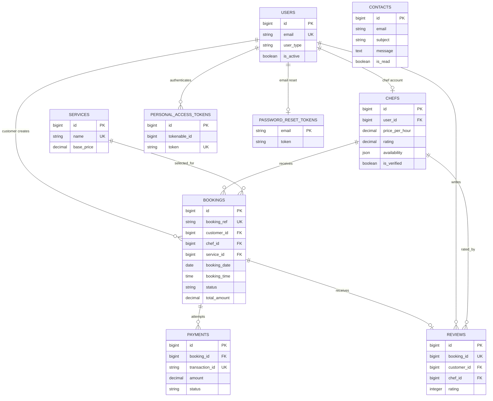

# ChefLagbe database relationship diagram

Contacts are independent inquiries. Password reset tokens use email as an application-level relationship rather than a foreign key. Sanctum tokens use polymorphic owner columns. Money uses decimal columns. The migrations are authoritative; use MySQL Workbench's reverse-engineering feature after migration to generate a physical schema diagram.
